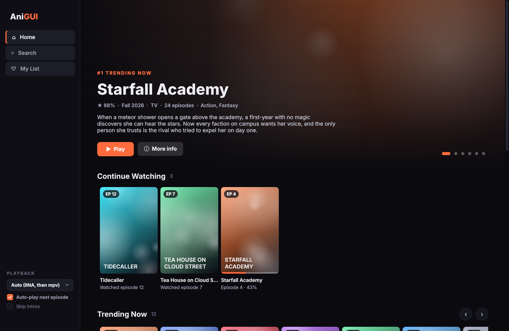
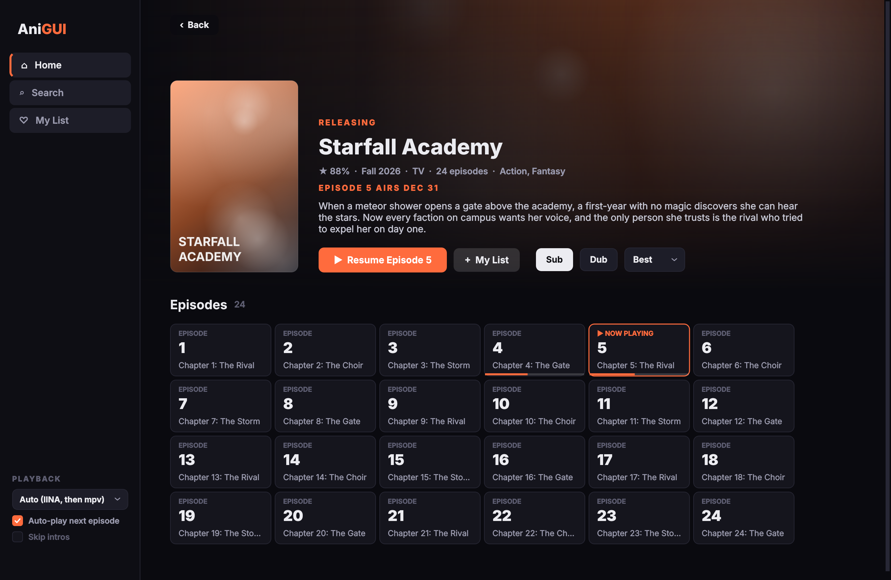
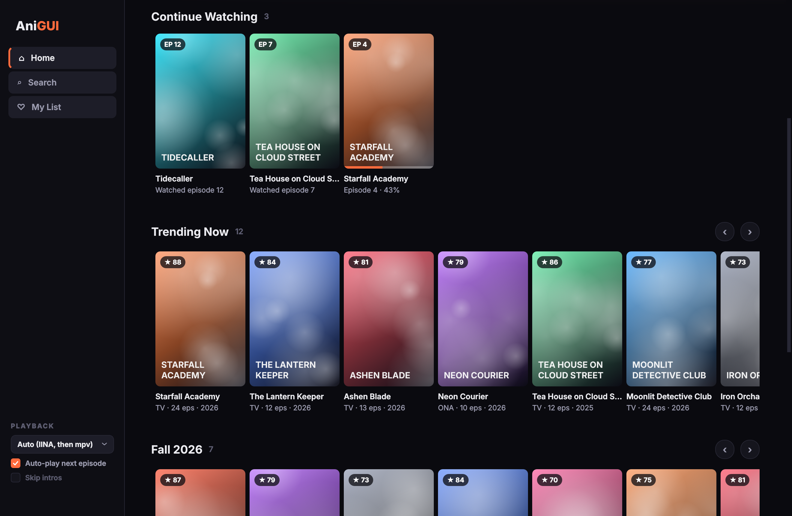
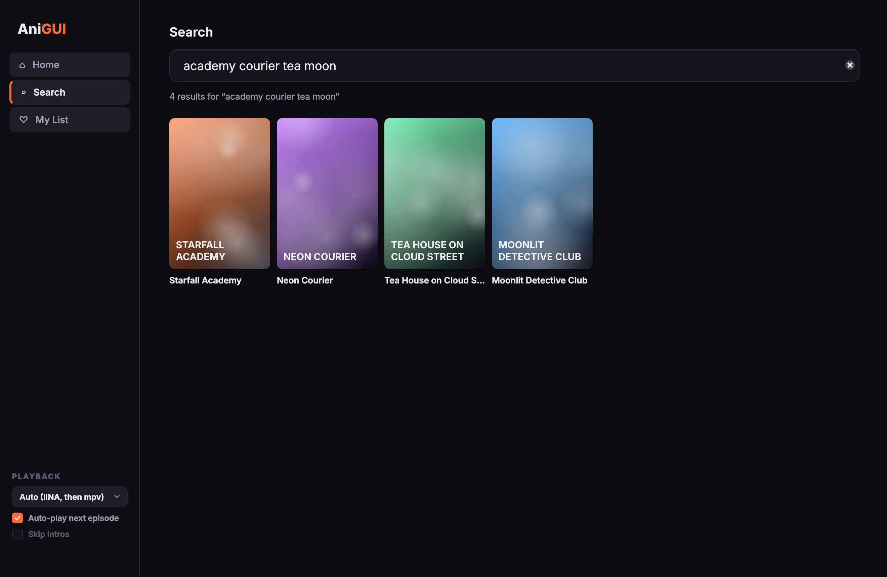
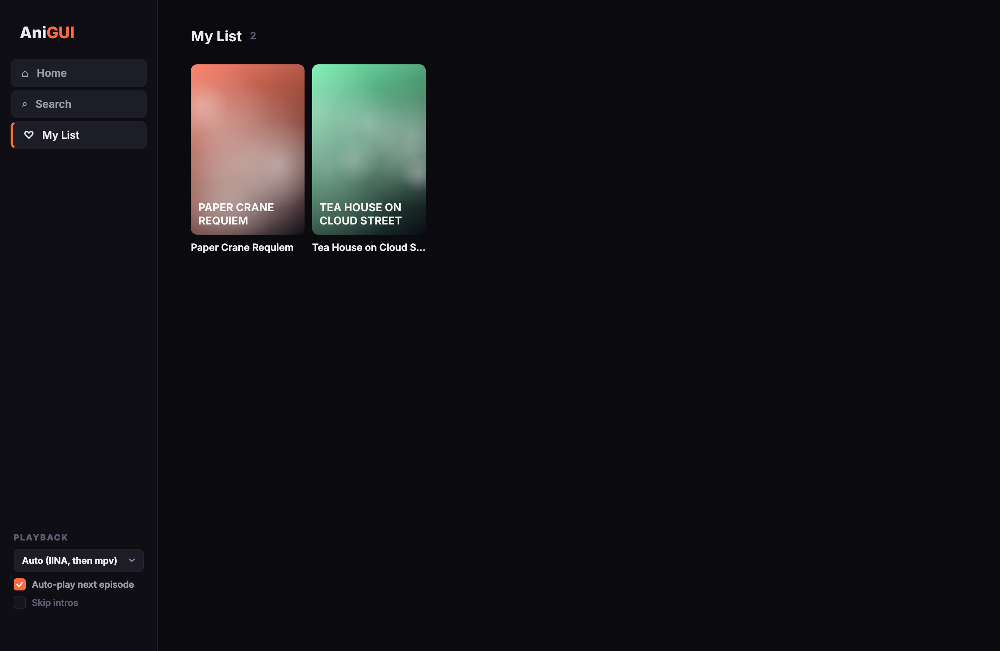
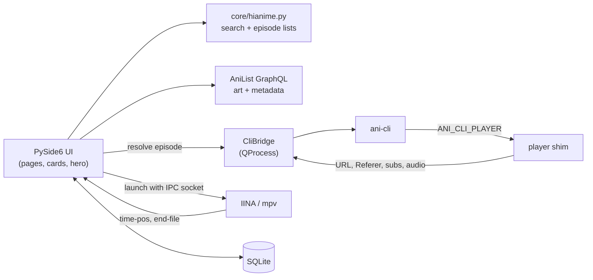

<p align="center">
  
</p>

<h1 align="center">AniGUI</h1>

<p align="center">
  A cinematic macOS app for <a href="https://github.com/pystardust/ani-cli">ani-cli</a>.<br>
  Browse, track and binge anime from a Netflix-style interface instead of the terminal.
</p>

<p align="center">
  <a href="https://github.com/JRodriguez-Luna/anigui/actions/workflows/tests.yml"></a>
  
  
  
  <a href="LICENSE"></a>
  <a href="https://github.com/JRodriguez-Luna/anigui/releases/latest"></a>
</p>

<p align="center">
  
</p>

<p align="center"><sub>Screenshots use AniGUI's built-in demo data: invented shows with generated artwork.</sub></p>

---

## Highlights

- **Home that feels like a streaming service:** a rotating spotlight of trending shows, plus rows for Continue Watching, Trending Now, This Season and My List.
- **Search as you type** across everything ani-cli can stream.
- **Rich show pages** with cover art, banners, scores, genres and next-episode countdowns from [AniList](https://anilist.co), plus Sub/Dub and quality choices.
- **One click to play** in [IINA](https://iina.io) or [mpv](https://mpv.io).
- **Real watch tracking** over mpv's IPC socket: your position saves as you watch, episodes count as watched past 90%, and Resume picks up exactly where you stopped.
- **Auto-play next:** the next episode is fetched in the background and starts in the same player window after a short countdown.
- **Picks up your terminal history:** shows you watched with `ani-cli` appear in Continue Watching, and outdated show IDs are repaired automatically.
- **A real Mac app:** builds into `AniGUI.app` with its own icon, so it lives in Applications and the Dock.

<table>
  <tr>
    <td width="50%"><p align="center"><sub>Show page: resume, Sub/Dub, quality, live progress</sub></p></td>
    <td width="50%"><p align="center"><sub>Continue Watching and Trending rows</sub></p></td>
  </tr>
  <tr>
    <td width="50%"><p align="center"><sub>Search as you type</sub></p></td>
    <td width="50%"><p align="center"><sub>My List</sub></p></td>
  </tr>
</table>

## Requirements

- macOS 13 or newer (Apple silicon or Intel)
- [Homebrew](https://brew.sh)
- Python 3.12 or newer (tested on 3.13 and 3.15): `brew install python`
- ani-cli and a player:

```sh
brew install ani-cli fzf             # fzf is required by ani-cli
brew install --cask iina             # or: brew install mpv
```

Optional: [ani-skip](https://github.com/synacktraa/ani-skip) enables "Skip intros" (mpv), and

```sh
brew install curl-impersonate        # only if searches report "Blocked by Cloudflare"
```

## Install

### Download (Apple silicon)

1. Install the requirements above (`ani-cli`, `fzf`, and IINA or mpv).
2. Download the latest **AniGUI-…-macOS-AppleSilicon.dmg** from [**Releases**](https://github.com/JRodriguez-Luna/anigui/releases/latest), open it, and drag **AniGUI** onto the **Applications** folder.

   > **Your browser may block the download.** Chrome in particular flags new apps that aren't signed by an Apple-registered developer as "dangerous". AniGUI is open source and built by GitHub Actions straight from this repo, but it isn't notarized (that needs a paid Apple account). To keep the file, open `chrome://downloads` and choose **Keep** (it may be under the **⋮** menu), or download it with **Safari**. If you'd rather not, [build it yourself](#build-from-source).

3. **First launch:** AniGUI isn't notarized by Apple, so macOS blocks it the first time. Open it once, then go to **System Settings → Privacy & Security** and click **Open Anyway**. Or run:
   ```sh
   xattr -dr com.apple.quarantine /Applications/AniGUI.app
   ```

To update, download the new release and replace the app. Your library and progress are stored separately and carry over.

### Build from source

Works on Apple silicon and Intel.

```sh
git clone https://github.com/JRodriguez-Luna/anigui.git
cd anigui
```

#### Option 1: build the app

Double-click **`Build AniGUI.app.command`** in Finder, or run it from Terminal:

```sh
./"Build AniGUI.app.command"
```

It sets up a virtual environment, builds `AniGUI.app` with PyInstaller, runs a self-test, installs the app to `/Applications` (or `~/Applications` if that isn't writable) and opens it. Building takes a minute or two. Run it again after `git pull` to update.

To keep AniGUI in the Dock, right-click its Dock icon → **Options** → **Keep in Dock**.

#### Option 2: run without building

```sh
python3 -m venv .venv
source .venv/bin/activate
pip install -r requirements.txt
python main.py
```

Or double-click **`AniGUI.command`**, which does the same and keeps the setup for next time.

## Using AniGUI

| | |
|---|---|
| **Play** | Click any episode, or the big Play / Resume button on a show page. |
| **Mark episodes** | Right-click an episode: mark watched, unwatched, or everything up to it. |
| **Playback settings** | Bottom of the sidebar: player (Auto, IINA or mpv), auto-play next, skip intros. |
| **Sub / Dub / quality** | On every show page; remembered between launches. |

**Keyboard shortcuts:** <kbd>⌘1</kbd> Home · <kbd>⌘2</kbd> Search · <kbd>⌘3</kbd> My List · <kbd>⌘F</kbd> jump to search · <kbd>⌘[</kbd> or <kbd>Esc</kbd> back

**Where your data lives**

| What | Where |
|---|---|
| Library, watch progress, metadata cache (SQLite) | `~/Library/Application Support/AniGUI/anigui.db` |
| Cover images (400 MB, oldest removed first) | `~/Library/Caches/AniGUI/covers/` |
| App log (when run as `AniGUI.app`) | `~/Library/Logs/AniGUI/anigui.log` |
| ani-cli history (read only, imported on launch) | `~/.local/state/ani-cli/ani-hsts` |

Rebuilding or updating the app never touches your data.

## How it works



- **ani-cli stays in charge of streams.** It does the hard, fast-changing part: decrypting embeds and picking stream URLs. AniGUI runs it headless and sets `ANI_CLI_PLAYER` to a tiny shim script that ani-cli treats as mpv. Instead of playing, the shim records the exact arguments ani-cli would have passed (stream URL, Referer header, subtitles, audio track, ani-skip flags), and `--exit-after-play` ends ani-cli before its interactive menu.
- **Search and episode lists are ported to Python** (`core/hianime.py`) so the UI stays fast. They use the same curl binary and TLS settings as ani-cli, so both get identical results, and the result order matches what `ani-cli -S <n>` selects.
- **AniList supplies the visuals.** `core/catalog.py` links hianime titles and AniList entries with a season-aware title matcher ("Season 2" never matches Season 1), and manual links always win. Before playing, it looks up the show's current position in search results (cached for 15 minutes), then confirms the title ani-cli returns, so a shifted search order can't play the wrong show.
- **Nothing blocks the UI.** Network and database work runs on a `QThreadPool` (`core/tasks.py`). Results return to the UI thread through signals, and "latest wins" groups drop stale results when you type or click quickly.
- **Tracking uses mpv's JSON IPC.** The player starts with `--input-ipc-server` (IINA: `--mpv-input-ipc-server`). AniGUI connects with `QLocalSocket`, observes `time-pos` and `duration`, and on `end-file` loads the next episode into the same window with `loadfile`.

## Project layout

```
anigui/
├── main.py                    entry point (also: --self-test)
├── core/                      no UI code
│   ├── hianime.py             search + episode lists
│   ├── ani_cli.py             headless ani-cli runner, version check, doctor
│   ├── cli_bridge.py          same, wrapped in QProcess with signals
│   ├── anilist.py             AniList GraphQL client with caching + rate-limit handling
│   ├── catalog.py             links hianime ⇄ AniList, resume logic, stale-ID repair
│   ├── store.py               SQLite: shows, My List, progress, TTL cache
│   ├── covers.py              on-disk image cache
│   ├── mpv_ipc.py             mpv JSON IPC client
│   ├── player.py              launches IINA / mpv
│   └── tasks.py               thread pool → UI-thread callbacks
├── ui/                        PySide6 interface
│   ├── main_window.py         sidebar, navigation, settings, startup checks
│   ├── home_page.py · search_page.py · library_page.py · detail_page.py
│   ├── playback.py            resolve → play → track → auto-next
│   ├── cards.py · hero.py · widgets.py · images.py · theme.py
├── packaging/                 icon generator, PyInstaller spec
├── tests/                     offline test suite + fakes
└── tools/                     terminal checks and the screenshot generator
```

## Development

```sh
source .venv/bin/activate
pytest -q
```

The 71 tests run fully offline, using:

- a **fake hianime** served by a stand-in `curl`, so the real ani-cli script runs its full scraping flow against fixtures (these tests are skipped if ani-cli isn't installed),
- a **fake AniList** transport,
- a **fake mpv** that speaks the JSON IPC protocol over a real Unix socket,
- **real widgets** rendered offscreen, driven through click-to-play, search, My List and auto-next.

GitHub Actions runs the suite on macOS and Ubuntu on every push, against a pinned ani-cli version. Pushing a version tag builds `AniGUI.app` on an Apple-silicon runner, self-tests it, packs it into a drag-to-install `.dmg` and publishes it as a GitHub Release:

```sh
# bump __version__ in core/__init__.py first
git tag v1.0.1 && git push origin v1.0.1
```

Or create the release on github.com with a new `v…` tag; the workflow attaches the `.dmg` and fills in the notes.

Handy tools:

```sh
python tools/step1_test.py --doctor          # check ani-cli, curl, fzf and player setup
python tools/step1_test.py "frieren" --play  # search → episodes → stream → player, from the terminal
python tools/step2_test.py --sandbox         # live AniList, matching and covers check
QT_QPA_PLATFORM=offscreen QT_SCALE_FACTOR=2 python tools/ui_preview.py docs/screenshots
```

## Troubleshooting

| Symptom | Fix |
|---|---|
| Chrome says the download is dangerous | AniGUI isn't notarized by Apple, so new downloads get flagged. Open `chrome://downloads` → **Keep**, use Safari, or build from source. |
| "AniGUI can't be opened" on first launch | **System Settings → Privacy & Security → Open Anyway**, or `xattr -dr com.apple.quarantine /Applications/AniGUI.app`. |
| A banner says playback needs tools | Install what it lists: `brew install ani-cli fzf` and IINA or mpv. |
| "Blocked by Cloudflare" | `brew install curl-impersonate`; AniGUI and ani-cli pick it up automatically. |
| "Playing without progress tracking" | Quit IINA and play again (it only accepts tracking for windows AniGUI opens), or choose **mpv** under Playback. |
| "This show isn't on hianime yet" | The title differs too much between AniList and hianime; use Search with another title. |
| Something else | Check `~/Library/Logs/AniGUI/anigui.log`, then open an issue with the log. |

AniGUI is tested against ani-cli **5.1.6**. `python tools/step1_test.py --doctor` warns if your version differs.

## Disclaimer

AniGUI is a desktop interface for ani-cli. It does not host, store or distribute any video. Streams come from third-party sites through ani-cli, exactly as when you run ani-cli in a terminal. This project is not affiliated with ani-cli, AniList, IINA, mpv or any streaming site. Use it at your own risk and in line with the laws where you live, and please support official releases where they're available.

## Credits

- [ani-cli](https://github.com/pystardust/ani-cli): the engine behind every stream
- [AniList](https://anilist.co): artwork and show information through its public API
- [mpv](https://mpv.io) and [IINA](https://iina.io): playback
- [Qt for Python (PySide6)](https://doc.qt.io/qtforpython-6/) and [PyInstaller](https://pyinstaller.org)

## License

[GPL-3.0](LICENSE). Parts of `core/hianime.py` are ported from ani-cli, which is GPL-3.0.

Made by [Jesus Rodriguez-Luna](https://github.com/JRodriguez-Luna).
